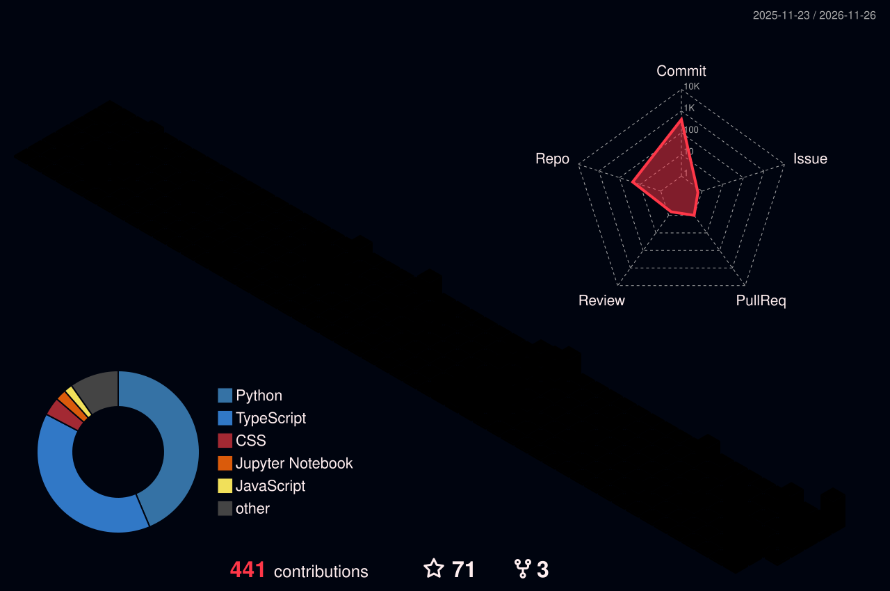

 

 

### 🕷️ Your friendly neighborhood dev, find me here

&nbsp;

 
&nbsp;

 
&nbsp;

 
&nbsp;

  

### 🕸️ Gamer, Phone Nerd, Photography Fan

🎮 GTA 5 on weekends 
📱 Mobile tech and troubleshooting 
📸 Photography 
📲 Curious how social platforms work 
🕷️ Spider-Man fan 
